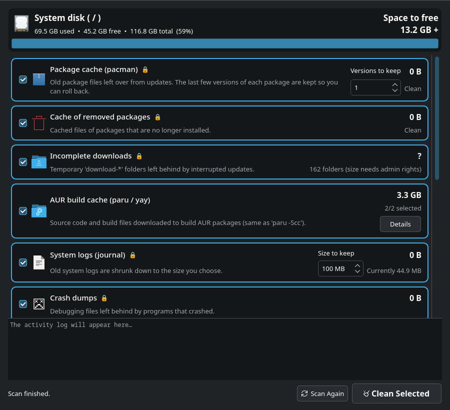

# System Cleaner

**English** | [Türkçe](README.tr.md) | [Português (Brasil)](README.pt-BR.md)

A graphical, mouse-driven disk cleanup tool for CachyOS / Arch Linux (PyQt6).
It runs commands like `paru -Scc`, `paccache` and `journalctl --vacuum-size` for you — no terminal needed.

## Languages
The app detects your system language automatically: **Türkçe**, **English**, **Português (Brasil)**.
If your system language is anything else, the app runs in English.
To choose the language manually: `SISTEM_TEMIZLEYICI_LANG=en sistem-temizleyici` (`tr`, `en` or `pt_BR`).

## Installation (once)
    git clone https://github.com/bariscagriyuce/system-cleaner.git
    cd system-cleaner
    sh kur.sh
It is installed as a package (tracked by pacman). Then find **System Cleaner** in your application menu.

## Uninstall
    sh kaldir.sh

## What it cleans
| Category | Equivalent | Admin |
|---|---|---|
| Package cache | `paccache -rk N` | 🔒 |
| Cache of removed packages | `paccache -ruk0` | 🔒 |
| Incomplete downloads | `/var/cache/pacman/pkg/download-*` | 🔒 |
| AUR build cache | `~/.cache/paru`, `~/.cache/yay` (`paru -Scc`) | |
| System logs | `journalctl --vacuum-size` | 🔒 |
| Crash dumps | `/var/lib/systemd/coredump` | 🔒 |
| Thumbnails | `~/.cache/thumbnails` | |
| Application/browser caches | `~/.cache/*` (selectable) | |
| Unused Flatpak runtimes | `flatpak uninstall --unused` | |
| Browser recovery backups | `~/.config/*-backup-crashrecovery-*` (profile-sync-daemon) | |
| Trash | `~/.local/share/Trash` | |
| Orphan packages | `pacman -Rns $(pacman -Qdtq)` (selectable) | 🔒 |

Browser caches do **not** contain your sessions, passwords, cookies or history — those live in
`~/.config` and are never touched.

🔒 steps run through a single pkexec password prompt, via `helper.py`, which only accepts a
whitelist of commands.

## Requirements
`python`, `python-pyqt6`, `pacman-contrib`, `polkit` (the install script pulls in the dependencies).

## License
MIT
