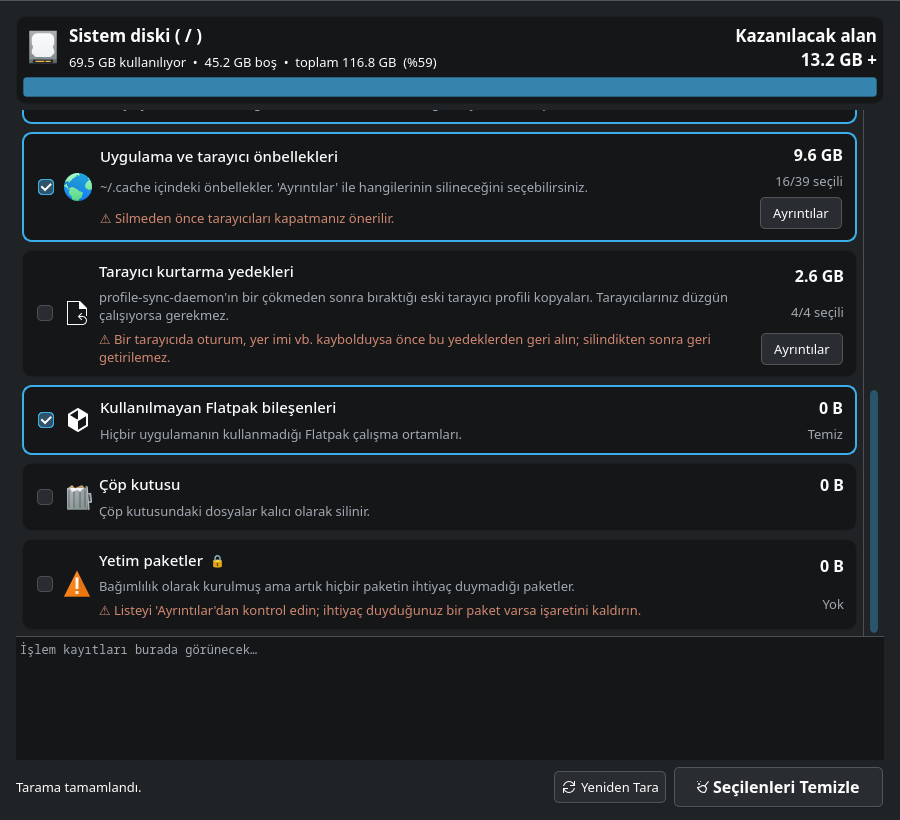

# Sistem Temizleyici

CachyOS / Arch Linux için fare ile kullanılan, grafik arayüzlü disk temizleme aracı (PyQt6).
`paru -Scc`, `paccache`, `journalctl --vacuum-size` gibi komutları terminal açmadan çalıştırır.

## Diller / Languages / Idiomas
Program sistem dilini otomatik algılar: **Türkçe**, **English**, **Português (Brasil)**.
Sistem dili bunlardan biri değilse program İngilizce açılır.
Dili elle seçmek için: `SISTEM_TEMIZLEYICI_LANG=en sistem-temizleyici`

*English:* The app follows your system language (Turkish, English or Brazilian Portuguese)
and falls back to English for any other language. Install with `sh kur.sh`.

*Português:* O aplicativo segue o idioma do sistema (turco, inglês ou português do Brasil)
e usa inglês para qualquer outro idioma. Instale com `sh kur.sh`.

## Kurulum (bir kez)
    git clone https://github.com/bariscagriyuce/system-cleaner.git
    cd system-cleaner
    sh kur.sh
Paket olarak kurulur (pacman tarafından takip edilir). Ardından uygulama menüsünde **Sistem Temizleyici**.

## Kaldırma
    sh kaldir.sh

## Neleri temizler
| Kategori | Karşılığı | Yetki |
|---|---|---|
| Paket önbelleği | `paccache -rk N` | 🔒 |
| Kaldırılmış paket önbelleği | `paccache -ruk0` | 🔒 |
| Yarım kalmış indirmeler | `/var/cache/pacman/pkg/download-*` | 🔒 |
| AUR derleme önbelleği | `~/.cache/paru`, `~/.cache/yay` (`paru -Scc`) | |
| Sistem günlükleri | `journalctl --vacuum-size` | 🔒 |
| Çökme dökümleri | `/var/lib/systemd/coredump` | 🔒 |
| Küçük resimler | `~/.cache/thumbnails` | |
| Uygulama/tarayıcı önbellekleri | `~/.cache/*` (seçilebilir) | |
| Kullanılmayan Flatpak | `flatpak uninstall --unused` | |
| Tarayıcı kurtarma yedekleri | `~/.config/*-backup-crashrecovery-*` (profile-sync-daemon) | |
| Çöp kutusu | `~/.local/share/Trash` | |
| Yetim paketler | `pacman -Rns $(pacman -Qdtq)` (seçilebilir) | 🔒 |

🔒 işlemler tek bir pkexec şifre penceresiyle, yalnızca beyaz listedeki komutları çalıştıran
`helper.py` üzerinden yapılır.

## Gereksinimler
`python`, `python-pyqt6`, `pacman-contrib`, `polkit` (kurulum betiği bağımlılıkları kendisi kurar).

## Lisans
MIT
