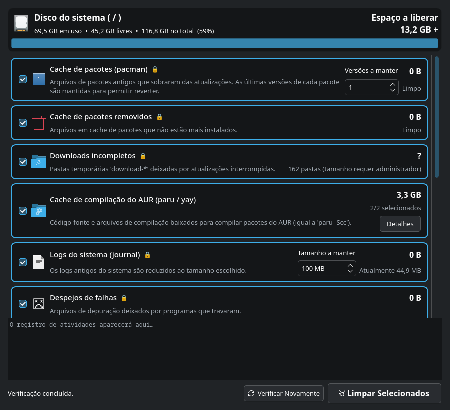

# Limpador do Sistema

[English](README.md) | [Türkçe](README.tr.md) | **Português (Brasil)**

Ferramenta gráfica de limpeza de disco para CachyOS / Arch Linux, usada com o mouse (PyQt6).
Executa comandos como `paru -Scc`, `paccache` e `journalctl --vacuum-size` sem precisar abrir o terminal.

## Idiomas
O aplicativo detecta o idioma do sistema automaticamente: **Türkçe**, **English**, **Português (Brasil)**.
Se o idioma do sistema for qualquer outro, o aplicativo abre em inglês.
Para escolher o idioma manualmente: `SISTEM_TEMIZLEYICI_LANG=pt_BR sistem-temizleyici` (`tr`, `en` ou `pt_BR`).

## Instalação (uma vez)
    git clone https://github.com/bariscagriyuce/system-cleaner.git
    cd system-cleaner
    sh kur.sh
É instalado como pacote (gerenciado pelo pacman). Depois, procure **Limpador do Sistema** no menu de aplicativos.

## Desinstalação
    sh kaldir.sh

## O que é limpo
| Categoria | Equivalente | Admin |
|---|---|---|
| Cache de pacotes | `paccache -rk N` | 🔒 |
| Cache de pacotes removidos | `paccache -ruk0` | 🔒 |
| Downloads incompletos | `/var/cache/pacman/pkg/download-*` | 🔒 |
| Cache de compilação do AUR | `~/.cache/paru`, `~/.cache/yay` (`paru -Scc`) | |
| Logs do sistema | `journalctl --vacuum-size` | 🔒 |
| Despejos de falhas | `/var/lib/systemd/coredump` | 🔒 |
| Miniaturas | `~/.cache/thumbnails` | |
| Caches de aplicativos/navegadores | `~/.cache/*` (selecionável) | |
| Componentes Flatpak não utilizados | `flatpak uninstall --unused` | |
| Backups de recuperação do navegador | `~/.config/*-backup-crashrecovery-*` (profile-sync-daemon) | |
| Lixeira | `~/.local/share/Trash` | |
| Pacotes órfãos | `pacman -Rns $(pacman -Qdtq)` (selecionável) | 🔒 |

Os caches dos navegadores **não** contêm suas sessões, senhas, cookies ou histórico — eles ficam
em `~/.config` e nunca são tocados.

As etapas 🔒 são executadas com uma única janela de senha do pkexec, por meio do `helper.py`,
que só aceita uma lista fixa de comandos.

## Requisitos
`python`, `python-pyqt6`, `pacman-contrib`, `polkit` (o script de instalação instala as dependências).

## Licença
MIT
